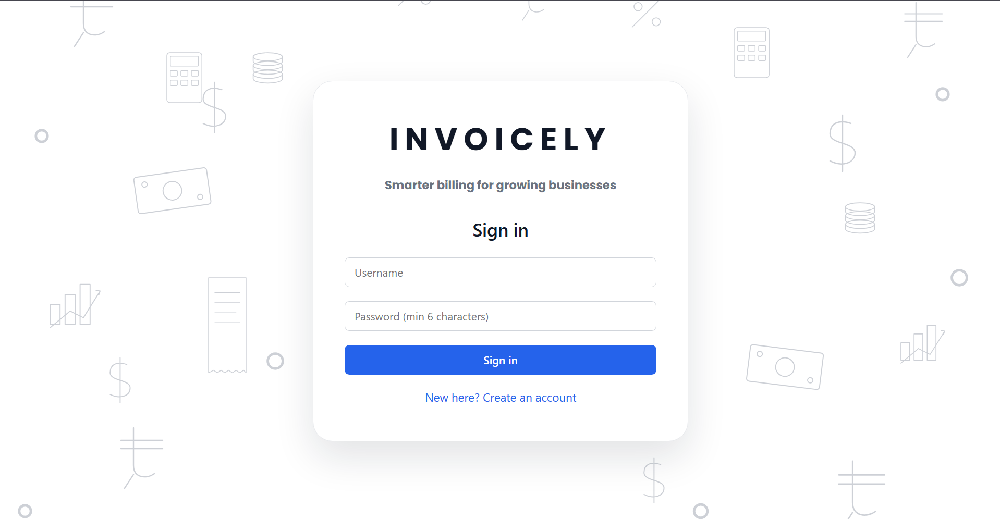
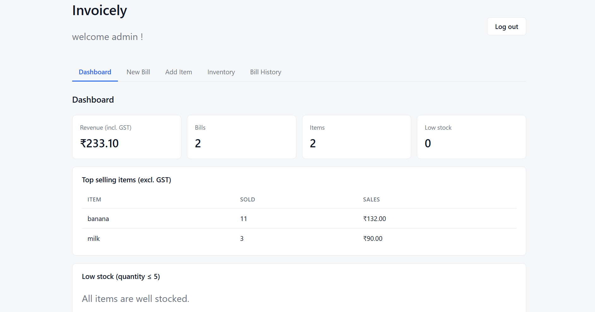
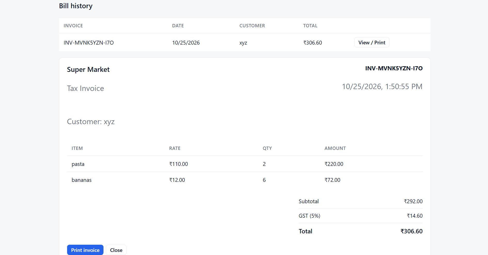

# Invoicely: Billing & Inventory System

&nbsp;
&nbsp;
&nbsp;
&nbsp;
&nbsp;

A full-stack billing and inventory application for small shops. Manage stock, create GST bills, print invoices, and track sales. Each account has its own inventory and bills.

---

## Features

- **Accounts:** Sign up and sign in with bcrypt-hashed passwords and JWT sessions that expire after 8 hours.
- **Inventory:** Add or restock items (name matching ignores capitals), edit and delete items, and view low-stock and out-of-stock badges.
- **Billing:** Build a bill from a cart with a customer name, automatic GST calculation, and a stock check before each item is added.
- **Stock Safety:** Checkout deducts stock using an atomic database update and restores it if checkout fails part-way.
- **Printable Invoices:** View and print invoices after checkout or from Bill History.
- **Dashboard:** Track revenue, bill count, item count, low-stock count, and the top 5 selling items using MongoDB aggregation.
- **Per-User Data:** Each account sees only its own inventory and bills.

### login page

### Dashboard

### Printable Invoice


---

## Tech Stack

| Layer | Technology |
|---|---|
| Frontend | React 18, Vite |
| Backend | Node.js, Express 4 |
| Database | MongoDB Atlas |
| ODM | Mongoose |
| Authentication | JSON Web Tokens (JWT) |
| Password Hashing | bcryptjs |
| Frontend Hosting | Vercel |
| Backend Hosting | Render |
| Database Hosting | MongoDB Atlas |

---

## Architecture

```text
Browser (React on Vercel)
          |
          | HTTPS
          | JWT sent with authenticated requests
          v
Express API (Render)
          |
          | Mongoose
          v
MongoDB Atlas
```

The application uses a React frontend to communicate with an Express API. The backend handles authentication, inventory, billing, and dashboard requests, while MongoDB Atlas stores the application data.

---

## Project Structure

```text
Invoicely/
├── README.md
├── screenshots/
│   ├── login.png
│   ├── dashboard.png
│   └── invoice.png
│
└── billing-mern/
    ├── client/
    │   └── src/
    │       ├── components/
    │       │   ├── Login
    │       │   ├── Dashboard
    │       │   ├── AddItem
    │       │   ├── Inventory
    │       │   ├── GenerateBill
    │       │   ├── Invoice
    │       │   └── BillHistory
    │       ├── api.js
    │       └── index.css
    │
    └── server/
        └── src/
            ├── routes/
            │   ├── auth.js
            │   ├── items.js
            │   ├── bills.js
            │   └── dashboard.js
            ├── models/
            │   ├── User.js
            │   ├── Item.js
            │   └── Bill.js
            ├── middleware/
            │   ├── auth.js
            │   └── errorHandler.js
            └── config/
                ├── db.js
                ├── billing.js
                └── seedAdmin.js
```

---

## API

| Method | Route | Auth | Purpose |
|---|---|---|---|
| POST | `/api/auth/register` | No | Create an account |
| POST | `/api/auth/login` | No | Sign in and get a token |
| GET | `/api/items` | Yes | List inventory items |
| POST | `/api/items` | Yes | Add or restock an item |
| PUT | `/api/items/:id` | Yes | Edit an item |
| DELETE | `/api/items/:id` | Yes | Delete an item |
| GET | `/api/bills` | Yes | View bill history |
| POST | `/api/bills` | Yes | Checkout and create a bill |
| GET | `/api/dashboard` | Yes | View dashboard totals and top-selling items |

---

## Run Locally

### Prerequisites

- Node.js 18 or later
- A MongoDB Atlas cluster
- npm

### 1. Install Dependencies

From the repository root, install the backend dependencies:

```bash
cd billing-mern/server
npm install
```

Install the frontend dependencies:

```bash
cd ../client
npm install
```

### 2. Configure Environment Variables

Copy `billing-mern/server/.env.example` to a file named `.env` in the same directory and fill in the required values.

The environment variables are:

| Variable | Purpose |
|---|---|
| `MONGO_URI` | MongoDB Atlas connection string |
| `JWT_SECRET` | Secret used to sign JWTs |
| `ADMIN_USERNAME` | Admin account username |
| `ADMIN_PASSWORD` | Admin account password |
| `CLIENT_ORIGIN` | Frontend origin, such as `http://localhost:5173` |
| `TAX_RATE` | GST percentage; default is `5` |
| `LOW_STOCK_THRESHOLD` | Low-stock limit; default is `5` |

Keep your `.env` file private and never commit credentials to GitHub.

### 3. Start the Backend

Open a terminal in VS Code:

```bash
cd billing-mern/server
npm run dev
```

### 4. Start the Frontend

Open a second terminal in VS Code:

```bash
cd billing-mern/client
npm run dev
```

### 5. Open the Application

Visit:

**http://localhost:5173**

Create a free account on the sign-in page to try Invoicely.

---
## Author

**Dwiti Patel**

- **GitHub Profile:** [@dwitipatell](https://github.com/dwitipatell)
- **Invoicely Repository:** [View Project](https://github.com/dwitipatell/Invoicely)
- **Live Demo:** [Try Invoicely](https://invoicely-dwiti.vercel.app)

